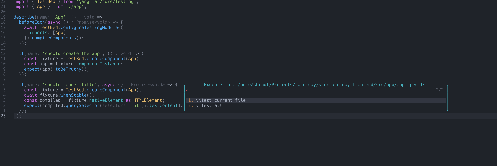
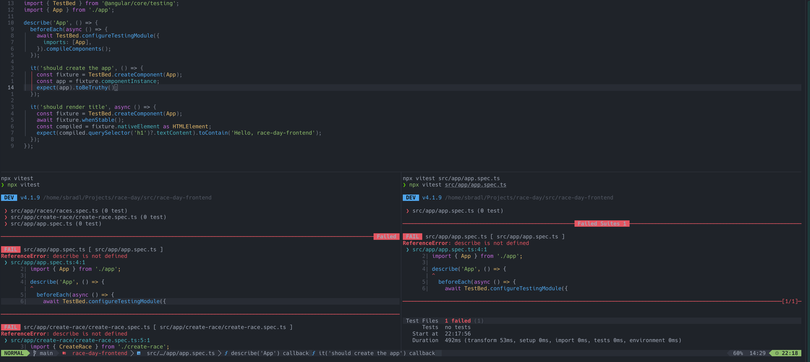

# command_runner.nvim

[](https://github.com/sbradl/command_runner.nvim/actions/workflows/ci.yml)

Pick and run commands for the current file: every task from
[mise](https://mise.jdx.dev), filled with context from the current buffer, plus
a few editor actions.

## run_command

Based on the current file a selection of commands is displayed.


The selected command will be executed when selected.


### Rerun and history

Every executed command is recorded in a history, most recent first (capped at
`history_size`, default 10 — see [Setup](#setup)). Repeating a command that's
already in history moves it back to the front instead of adding a duplicate.

`require("command_runner").rerun_command()` replays the most recent entry
directly, without showing a picker (it warns when no command has been run
yet):

```lua
vim.keymap.set("n", "<leader>rr", require("command_runner").rerun_command, { desc = "Rerun last command" })
```

`require("command_runner").show_history()` opens a picker over the whole
history. Selecting an entry re-executes it and moves it to the front:

```lua
vim.keymap.set("n", "<leader>rh", require("command_runner").show_history, { desc = "Command history" })
```

`require("command_runner").rerun_command_description()` returns a string
describing what `rerun_command()` would run (e.g. `"Rerun: run — make — src"`),
or `nil` when history is empty. The directory is shortened relative to its git
repository root, or to Neovim's cwd when it isn't inside one. Use it for a
dynamic which-key `desc` (which-key
re-evaluates a function `desc` each time the popup opens — `vim.keymap.set`'s
`desc` can't do this, it must be a static string):

```lua
require("which-key").add({
  {
    "<leader>rr",
    require("command_runner").rerun_command,
    desc = function()
      return require("command_runner").rerun_command_description() or "Rerun last command"
    end,
  },
})
```

Both are snapshots: they repeat the command exactly as it ran before — same
command line, same directory — even if the current buffer has changed in the
meantime (e.g. tests that ran in project A are rerun in project A, even from
a file in project B), and are independent of the current file's extension.
History is kept for the duration of the Neovim session only.

## install_tasks

Ecosystem commands (dotnet test, vitest, go, mix, docker compose, ...) ship as
mise task templates in [`templates/`](./templates).
`require("command_runner").install_tasks()` opens a checklist for the current
project (git root, else cwd). Templates detected from marker files are
pre-checked. Press `x` to toggle a line and `:w` to copy the checked ones to
`.mise/conf.d/command_runner_<name>.toml` and `mise trust` them. mise picks
them up automatically, with no `mise.toml` required. Files that are already
installed are never overwritten, so edit them freely.

```lua
vim.keymap.set("n", "<leader>ri", require("command_runner").install_tasks, { desc = "Install mise tasks" })
```

### Passing the current file

When you pick a task, the plugin reads its
[usage spec](https://mise.jdx.dev/tasks/task-arguments.html) and passes each
arg or flag it recognises by name:

| name        | value                                                    |
| ----------- | -------------------------------------------------------- |
| `file`      | current file, relative to the task dir                   |
| `line`      | cursor line                                              |
| `dir`       | current file's directory, `./`-prefixed                  |
| `test_class`, `test_method`, `test_namespace` | C# class/method/namespace at the cursor, only in a test file (`[TestClass]`, `[Fact]`, `[Test]`, ...) |
| `project`   | nearest `.csproj`, relative to the task dir              |
| `--mtp`     | flag, set when `global.json` selects Microsoft.Testing.Platform |

Arguments are filled in order, stopping at the first name it doesn't
recognise. A task is only offered when every required `<arg>` with one of these
names gets a value, e.g. `dotnet:test-method` only shows up in a C# test file
with the cursor inside a method. Tasks without args are offered everywhere
in the project, and so are script-file tasks (`mise tasks ls` doesn't report
their usage). The same task works from a shell:

```toml
[tasks."vitest:file"]
usage = 'arg "<file>"'
run = 'npx vitest "{{usage.file}}"'
```

## Requirements

- Neovim (with `vim.fs`, i.e. 0.8+).
- [terminal.nvim](https://github.com/sbradl/terminal.nvim) — a runtime dependency, but only for commands executed in a terminal (`type = "terminal"`, the default). Commands with `type = "nvim"` do not need it.

## Installation

Using [lazy.nvim](https://github.com/folke/lazy.nvim):

```lua
{
 "sbradl/command_runner.nvim",
 dependencies = { "sbradl/terminal.nvim" },
 config = function()
  require("command_runner").setup()

  -- Bind the picker to a key of your choice.
  vim.keymap.set("n", "<leader>rc", require("command_runner").run_command, { desc = "Run command" })
 end,
}
```

## Setup

Call `require("command_runner").setup(opts)` once. Calling it again replaces the
previous configuration. `opts` is optional; with no arguments every builtin is
enabled.

```lua
require("command_runner").setup({
 -- Builtins are opt-out: list the keys you want to disable.
 builtin = {
  disable = { "ts_npm" },
 },

 -- Close the terminal automatically when a command exits successfully
 -- (defaults shown).
 autoclose_on_success = true,
 autoclose_delay_in_seconds = 3,

 -- Number of recent commands kept for the history picker (default shown).
 history_size = 10,
})
```

### Autoclose

With `autoclose_on_success` enabled (the default), terminal commands are sent
as `<command_line> && sleep <delay> && exit`: on success the shell exits after
`autoclose_delay_in_seconds` and Neovim deletes the terminal buffer; on failure
the shell stays open with the output. Pressing `Ctrl-C` during the delay
cancels the pending `exit` and keeps the terminal. A delay of `0` closes
immediately.

The buffer deletion is done via our own `TermClose` autocmd (checking
`v:event.status == 0`), not Neovim's built-in one — the built-in autocmd only
fires when the job's argv string-matches `'shell'` exactly, which is unreliable
on Windows (see [neovim#28384](https://github.com/neovim/neovim/issues/28384)).

This requires a shell where the `&&` chain is valid — any POSIX shell or
PowerShell 7+ (where `sleep` aliases `Start-Sleep`). On Windows the final
`exit` is sent as `[Environment]::Exit(0)` instead, since PowerShell's `exit`
keyword isn't valid on the right-hand side of `&&`. Notably `cmd.exe` and
Windows PowerShell 5.1 are not supported; set `autoclose_on_success = false`
there.

### Builtins

Builtins are the few non-mise commands — editor actions (open `.sln`/`.csproj`,
edit `package.json`), executing the current script — plus the `mise` builtin
that lists all tasks. Each is enabled by default.
Builtins are autoloaded from [`lua/command_runner/builtin`](./lua/command_runner/builtin);
each file is named `<ext>_<name>.lua`, and its key is that filename without the
`.lua` extension (e.g. `ts_npm`, `cs_dotnet`). See that directory for the
full list and the commands each one provides.

Disable specific builtins by listing their keys in `builtin.disable`:

```lua
require("command_runner").setup({
 builtin = {
  disable = { "ts_npm", "sh_script" },
 },
})
```

Or disable all of them at once with `builtin = false`:

```lua
require("command_runner").setup({ builtin = false })
```

## Custom commands

There is no custom command configuration. For project-specific commands, the
recommended approach is to define them as [mise tasks](https://mise.jdx.dev/tasks/)
in your project's `mise.toml`. The `mise` builtin lists every task in the picker
for any buffer inside a mise project:

```toml
[tasks.serve]
description = "Start the dev server"
run = "npm run dev"
```
