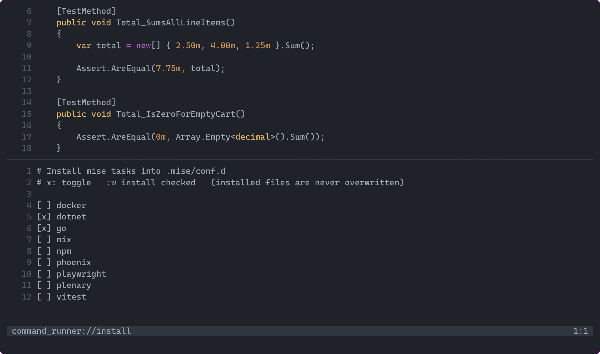
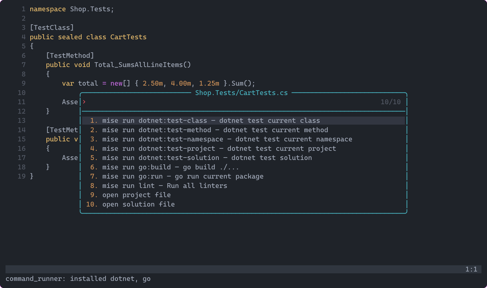
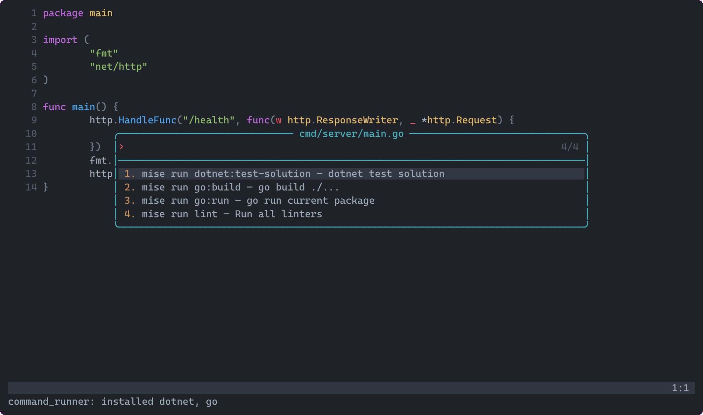
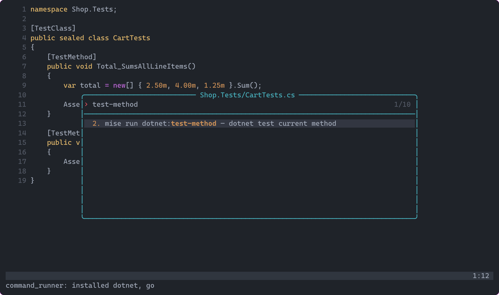
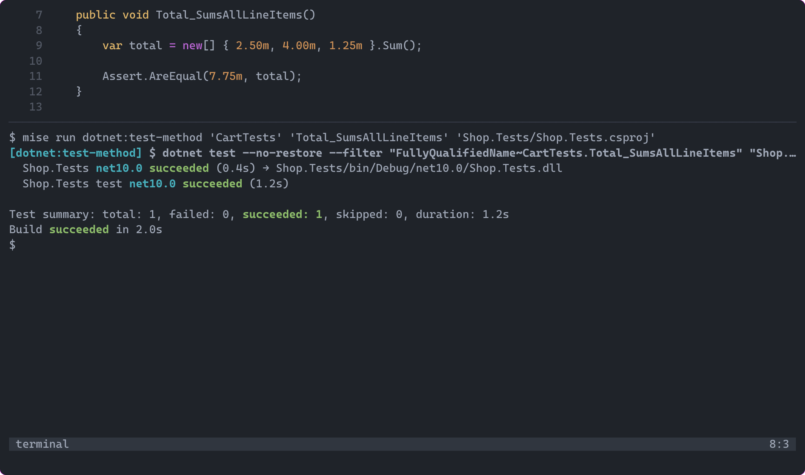

# command_runner.nvim

[](https://github.com/sbradl/command_runner.nvim/actions/workflows/ci.yml)
[](https://github.com/sbradl/command_runner.nvim/actions/workflows/e2e.yml)

Run your project's [mise](https://mise.jdx.dev) tasks from Neovim, with the
current file, cursor line, test class or test method filled in for you.

The plugin doesn't hard-code commands like "dotnet test current method". It
ships them as **mise task templates** that you install into a project once.
After that they are ordinary mise tasks: you can edit them, commit them, and
run them from a shell too. When you run one from Neovim, the plugin passes in
context from the current buffer.

> **Experimental:** on this branch every ecosystem command is a mise task. The
> old autodetected builtins (`ts_vitest`, `cs_dotnet_test`, `ex_mix`, ...) are
> gone.

## Quick start

```lua
-- lazy.nvim
{
  "sbradl/command_runner.nvim",
  dependencies = { "sbradl/terminal.nvim" },
  config = function()
    local r = require("command_runner")
    r.setup()

    vim.keymap.set("n", "<leader>rc", r.run_command, { desc = "Run command" })
    vim.keymap.set("n", "<leader>ri", r.install_tasks, { desc = "Install mise tasks" })
    vim.keymap.set("n", "<leader>rr", r.rerun_command, { desc = "Rerun last command" })
    vim.keymap.set("n", "<leader>rh", r.show_history, { desc = "Command history" })
  end,
}
```

Requirements:

- Neovim 0.12+
- [mise](https://mise.jdx.dev) on your `PATH`
- [terminal.nvim](https://github.com/sbradl/terminal.nvim), which tasks run in

## 1. Install tasks into your project

Run `install_tasks()` in a project. It opens a checklist of the bundled
templates. Templates matching the project's marker files (`*.csproj`,
`go.mod`, `mix.exs`, `package.json`, ...) are already checked.



Press `x` to toggle a line and `:w` to install. Each checked template is copied
to `.mise/conf.d/command_runner_<name>.toml` in the project root (git root, or
cwd) and `mise trust`ed. mise loads `conf.d` on its own, so no `mise.toml` is
needed.

Installed files are yours. They are never overwritten, so edit them freely. To
get a fresh copy, delete the file and install again.

### Bundled templates

| Template     | Pre-checked when the project has                | Tasks                                                        |
| ------------ | ----------------------------------------------- | ------------------------------------------------------------ |
| `dotnet`     | `*.sln`, `*.slnx`, `*.csproj`                   | `test-class`, `test-method`, `test-namespace`, `test-project`, `test-solution` |
| `go`         | `go.mod`                                        | `run` (current package), `build`                             |
| `vitest`     | `vitest.config.ts`/`.js`                        | `file`, `all`                                                |
| `playwright` | `playwright.config.ts`                          | `test`                                                       |
| `npm`        | `package.json`                                  | `build`                                                      |
| `mix`        | `mix.exs`                                       | `compile`, `test`, `release`                                 |
| `phoenix`    | `mix.exs`                                       | `server`                                                     |
| `docker`     | `compose.yml`, `docker-compose.yml`, ...        | `up`, `down`, `build`, `logs`, `ps`, `restart`               |
| `plenary`    | never pre-checked                               | `file`, `all` (headless nvim with your config)               |

Tasks are named `<template>:<task>`, e.g. `dotnet:test-method`. All templates
use inline TOML `run` commands, so they work on Linux, macOS and Windows.

## 2. Pick a task

`run_command()` lists every mise task in the project, plus a few editor actions
(open `.sln`/`.csproj`, edit `package.json`, run the current script). Tasks are
only offered when they make sense for the current buffer. In a C# test file
you get the per-class and per-method test tasks:



In a Go file the same project offers no class or method tests:



Your own tasks from `mise.toml` (like `lint` above) appear alongside the
installed ones.

## 3. Run it

Type to filter, then press Enter:



The plugin fills the task's arguments from the buffer and runs it in a
terminal at the project root:



The command line is a plain `mise run`, so you can copy it and run it from any
shell.

## How context is passed

Tasks declare arguments with mise's
[usage spec](https://mise.jdx.dev/tasks/task-arguments.html). When an argument
or flag has one of these names, the plugin fills it in:

| Name                                            | Value                                                                   |
| ----------------------------------------------- | ----------------------------------------------------------------------- |
| `file`                                          | current file, relative to the task dir                                  |
| `line`                                          | cursor line                                                             |
| `dir`                                           | current file's directory, `./`-prefixed                                 |
| `test_class`, `test_method`, `test_namespace`   | C# class, method or namespace at the cursor, only in a test file (`[TestClass]`, `[Fact]`, `[Test]`, ...) |
| `project`                                       | nearest `.csproj`, relative to the task dir                             |
| `--mtp` (flag)                                  | set when `global.json` selects Microsoft.Testing.Platform               |

- **Availability:** a task is offered only if every required `<arg>` with one
  of these names gets a value. That's why `dotnet:test-method` shows up only
  in a C# test file with the cursor inside a method.
- **Not filtered:** tasks without arguments show everywhere in the project.
  Script-file tasks always show too, because `mise tasks ls` doesn't report
  their usage.
- **Fill order:** arguments are passed in order, stopping at the first name
  the plugin doesn't know. mise reports anything still missing.

### Writing your own

Any mise task can opt in. For example, in `mise.toml`:

```toml
[tasks."spec:file"]
description = "Run the current spec file"
usage = 'arg "<file>"'
run = 'bundle exec rspec "{{usage.file}}"'

[tasks."spec:line"]
description = "Run the example at the cursor"
usage = '''
arg "<file>"
arg "<line>"
'''
run = 'bundle exec rspec "{{usage.file}}:{{usage.line}}"'
```

From a shell, pass the arguments yourself:
`mise run spec:file spec/cart_spec.rb`.

## Rerun and history

Every command you run is recorded, most recent first. Running the same command
again moves it to the front instead of duplicating it.

- `rerun_command()` replays the most recent entry without a picker.
- `show_history()` opens a picker over the whole history.
- `rerun_command_description()` returns a `"Rerun: <label> — <command line>"`
  description of the last command, or `nil` when history is empty. Use it for
  a dynamic which-key `desc`:

```lua
require("which-key").add({
  {
    "<leader>rr",
    require("command_runner").rerun_command,
    desc = function()
      return require("command_runner").rerun_command_description() or "Rerun last command"
    end,
  },
})
```

History entries are snapshots: a rerun uses the same command line and
directory as the original run, even from another buffer or project. History
lasts for the Neovim session only.

## Setup options

`setup(opts)` is optional, and calling it again replaces the previous
configuration.

```lua
require("command_runner").setup({
  -- Builtins (non-mise editor actions + the mise task list) are opt-out.
  builtin = {
    disable = { "ts_npm" }, -- or `builtin = false` to disable all
  },

  -- Close the terminal when a command succeeds (defaults shown).
  autoclose_on_success = true,
  autoclose_delay_in_seconds = 3,

  -- Entries kept for show_history().
  history_size = 10,
})
```

The builtins live in [`lua/command_runner/builtin`](./lua/command_runner/builtin).
Each one's key is its filename without `.lua`:

| Key         | Provides                                       |
| ----------- | ---------------------------------------------- |
| `mise`      | every mise task in the project                 |
| `cs_dotnet` | open solution file, open project file          |
| `ts_npm`    | edit `package.json`                            |
| `sh_script` | execute the current `.sh`/`.ps1` script        |

### Autoclose

With `autoclose_on_success`, a command is sent to the terminal as
`<command> && sleep <delay> && exit`:

- **On success:** the shell exits after the delay and the terminal buffer is
  deleted.
- **On failure:** the terminal stays open with the output.
- **Keeping it open:** press `Ctrl-C` during the delay.

This needs a shell where `&&` works: any POSIX shell, or PowerShell 7+. On
Windows, `exit` is sent as `[Environment]::Exit(0)`. `cmd.exe` and Windows
PowerShell 5.1 aren't supported there, so set `autoclose_on_success = false`.

## Development

```sh
# unit tests (needs ../plenary.nvim)
nvim --headless --noplugin -u scripts/minimal_init.vim \
  -c "PlenaryBustedDirectory tests/ { minimal_init = './scripts/minimal_init.vim' }"

# end-to-end against real mise, go and dotnet (CI runs it on Linux and Windows)
nvim -l scripts/e2e.lua
```

To add a template, create `templates/<name>.toml` and add a marker entry to
`M.detect` in [`lua/command_runner/install.lua`](./lua/command_runner/install.lua).
